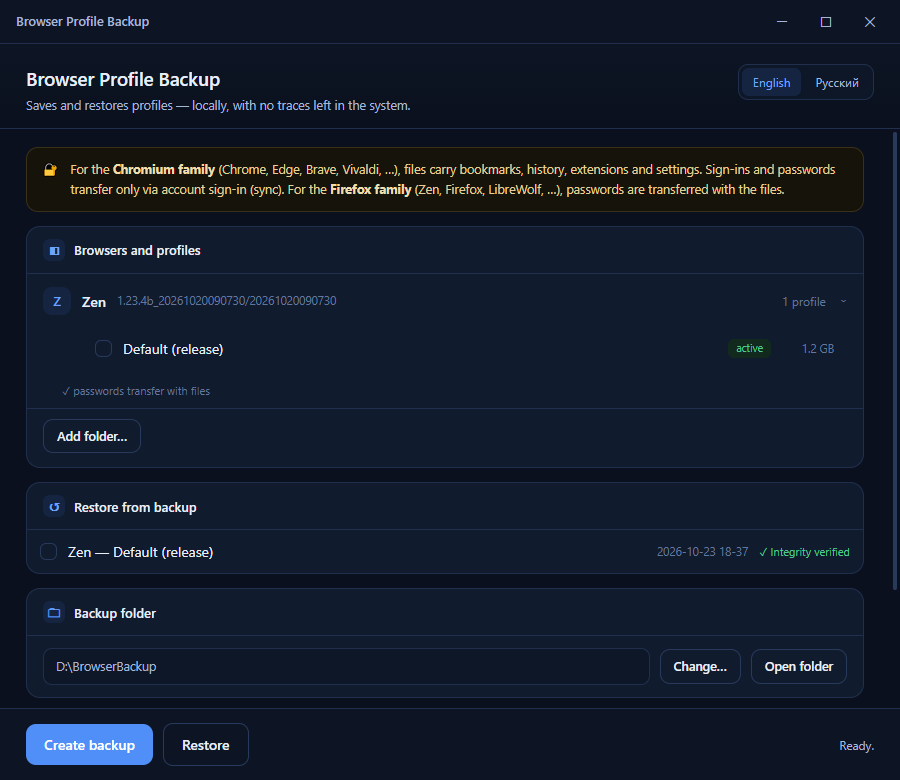

# BrowserBackup

**A portable Windows utility that backs up and restores browser profiles.**
One `.exe`, no installation. Writes nothing to the system — not to the registry, not to `%APPDATA%`.

<p align="center">
  
</p>

---

## Download

**[⬇️ Latest release](https://github.com/Hayden-Wright/browser-backup-tool/releases/latest)** → `BrowserBackup.exe`

Double-click to run. No installation needed — it runs from a USB stick.
On first launch SmartScreen may warn about an "unknown publisher" (the file has no
paid code-signing certificate) — click **"More info" → "Run anyway"**.

> **Requirements:** Windows 10/11 (64-bit). Needs the **WebView2 Runtime** — it is
> preinstalled on Windows 11 and most Windows 10 builds. If the window does not open,
> install [Microsoft Edge WebView2 Runtime](https://developer.microsoft.com/microsoft-edge/webview2/).

---

## Features

- 🔒 **Fully portable** — settings live next to the `.exe`, the engine's temporary data
  is deleted on exit, nothing is left in the user profile or the registry.
- 🧩 **Many browsers** — Firefox and Chromium families are detected automatically,
  plus an "Other browser" mode for anything else.
- ✅ **Integrity checking** — SHA-256 is computed on the fly while copying, so a damaged
  backup shows up immediately instead of being silently broken.
- 🛟 **Safe restore** — your current profile is not deleted: a safety copy (`_safety`)
  is made first, so you can roll back at any time.
- ⚡ **Responsive UI** — long operations run in the background, the window never freezes.
- 🌐 **English / Русский** — English is the default; Russian is a full second language,
  switched in the window.

---

## Supported browsers

| Family | Browsers | Passwords |
|---|---|---|
| **Firefox** | Zen, Firefox, LibreWolf, Waterfox, Floorp | ✅ transferred as files |
| **Chromium** | Chrome, Edge, Brave, Vivaldi, Chromium, Thorium, Ungoogled Chromium, SRWare Iron, Helium, Arc | ⚠️ only via account sync |
| **Other** | any — pick the profile folder manually | depends on the browser |

### About passwords — this matters

- **Firefox family** stores passwords and sign-ins inside the profile — after a restore
  you will be logged in everywhere, just like before.
- **Chromium family** encrypts passwords and cookies with your Windows account key.
  After reinstalling Windows the key changes, so old passwords and cookies
  **will not decrypt**, even if the files were copied perfectly. Files carry bookmarks,
  history, extensions and settings; sign-ins and passwords come back **only via
  account sign-in (Google/Microsoft/Brave/…)** with sync enabled.

The app warns about this right in the window, next to each such browser.

---

## How to use

**Backup**
1. Run `BrowserBackup.exe`.
2. In "Browsers and profiles", click a browser — its profile list expands; tick the ones
   you need.
   - "active" — the profile you are using right now;
   - "empty" — a service folder with no data (nothing to back up). Zen may keep an empty
     "Default Profile" placeholder next to your working profile — that is **not** a duplicate.
3. Set the "Backup folder" with the "Change…" button.
   > ⚠️ Do not keep the backup on drive `C:` — it will be wiped when Windows is reinstalled.
   > The app warns you about this.
4. Click "Create backup". **The browser must be closed** — otherwise some files cannot be
   copied and the app will not let you continue.

**Restore**
1. Install the browser(s), run each one **once** and close it — so the browser creates a
   fresh profile folder itself.
2. Run `BrowserBackup.exe`, point it at the same backup folder.
3. In "Restore from backup", tick what you need and click "Restore".

---

## How it works

- The profile is transferred into the folder created by the **new** browser, not into a
  folder with the old random id — that is what makes it work correctly.
- **The cache is not copied** — it is not needed to carry data over and takes a lot of space.
- **Site file storage is not copied either** (`storage/<site>/fs`). Sites keep arbitrary
  blobs there — offline copies, game assets, downloaded resources — and it adds up fast:
  on the author's Zen profile it was 695 MB of 1043 MB. IndexedDB and localStorage *are*
  copied: that is where web-app state and sign-ins live.
- Every backup is a separate folder with a date and time in its name
  (`zen_Default (release)_2026-10-09_18-41-12`). A new backup **never** overwrites an old one.
- Inside a backup — `manifest.json` and `README.txt` (in Russian: `ПРОЧТИ_МЕНЯ.txt`): browser
  and version, profile, date, Windows, computer, user, file count, size, checksums.
- Every action is written to `browser-backup.log` in the backup folder. The "Open log file"
  button opens the log itself, "Open folder" opens the folder in Explorer.
- Human-readable error messages instead of codes.

---

## Portability and settings

The app **leaves no traces** in the system:

| What | Where |
|---|---|
| Settings (backup folder, language, "Other browser") | `BrowserBackup-settings.json` **next to the `.exe`** |
| WebView2 temporary data (tens of MB) | in the Windows temp folder, **deleted on exit** |
| Log | `browser-backup.log` in the backup folder |
| Registry / `%APPDATA%` | **not used** |

You can move the folder with the `.exe` to a USB stick — the settings travel with it.
Delete `BrowserBackup-settings.json` — settings reset to defaults.

**Custom browser list.** Put a `browsers.json` file next to the `.exe` — it will be used
instead of the built-in list:

```json
{
  "browsers": [
    { "key": "mybrowser", "name": "My Browser", "family": "firefox",
      "proc": ["mybrowser"], "roaming": "MyBrowser", "local": "MyBrowser" },
    { "key": "other", "name": "Other", "family": "chromium",
      "proc": ["other"], "local": "Other/User Data" },
    { "key": "fork", "name": "Chrome Fork", "family": "chromium",
      "proc": ["chrome"], "proc_path": "vendor/fork/application/chrome.exe",
      "local": "Vendor/Fork/User Data" }
  ]
}
```

`family`: `"firefox"` (profiles in `%APPDATA%`, passwords transfer as files) or
`"chromium"` (profiles in `%LOCALAPPDATA%`, passwords only via account sync).
`roaming` / `local` / `packages` — candidate paths (several can be given via `|`).
If the file is missing or damaged, the built-in list is used.

`proc_path` is optional and only needed for forks whose executable is named like another
browser's. Helium ships `chrome.exe`, so a name check cannot tell it apart from Google
Chrome; with `proc_path` the app compares full process paths instead. If process paths
cannot be read, it falls back to the name check.

---

## 🔐 Security note

For the Firefox family the backup contains **passwords and live sessions** — effectively
the keys to your accounts. Do not upload the backup folder to cloud storage or messengers.
Keep it on an encrypted disk (BitLocker / VeraCrypt) to be safe.

---

## Building from source

Requires [Go](https://go.dev/dl/) 1.26+. Cross-compiling for Windows (including from WSL):

```sh
GOOS=windows GOARCH=amd64 GOFLAGS=-mod=mod \
  go build -ldflags "-s -w -H windowsgui" -o BrowserBackup.exe .
```

> The `-H windowsgui` flag is required — otherwise an extra console window opens on launch.

Logic tests (hashes, manifest, settings) run on Linux:

```sh
GOOS=linux go test .
```

Details on the project's internals and history are in [`HANDOFF.md`](HANDOFF.md).

---

## Tech

Go · WebView2 (built-in engine) · custom COM folder picker (`IFileOpenDialog`) ·
SHA-256 on the fly while copying · no external dependencies except `go-webview2`,
`go-ole`, `golang.org/x/sys`.

## License

Provided "as is", without warranty. Use at your own risk — always verify a backup
before restoring.

---

<details>
<summary><b>Русский</b></summary>

**BrowserBackup** — портативная утилита для Windows: сохраняет и восстанавливает
профили браузеров. Один `.exe`, без установки. Ничего не пишет в систему — ни в
реестр, ни в `%APPDATA%`.

- **Скачать:** [последний релиз](https://github.com/Hayden-Wright/browser-backup-tool/releases/latest) → `BrowserBackup.exe`.
- **Требуется:** Windows 10/11 x64 + WebView2 Runtime (есть в Windows 11).
  При первом запуске SmartScreen предупредит о «неизвестном издателе» —
  «Подробнее» → «Выполнить в любом случае».
- **Firefox-семейство** (Zen, Firefox, LibreWolf, Waterfox, Floorp): пароли лежат
  в профиле и **переносятся файлами**.
- **Chromium-семейство** (Chrome, Edge, Brave, Vivaldi, Helium, …): пароли и куки
  зашифрованы ключом учётной записи Windows, поэтому после переустановки Windows
  **не расшифруются** — входы возвращаются только через синхронизацию аккаунта.
  Закладки, история, расширения и настройки переносятся.
- **Бэкап:** раскройте браузер → отметьте профили → выберите папку (**не на `C:`**) →
  «Создать бэкап». Браузер должен быть закрыт. Целостность (SHA-256) проверяется на лету.
- **Восстановление:** установите браузер, запустите его один раз и закройте, затем
  «Восстановить». Сначала делается страховочная копия текущего профиля, ничего не удаляется.
- Настройки лежат в `BrowserBackup-settings.json` рядом с `.exe` — папку можно переносить
  целиком вместе с настройками.
- Интерфейс: **English / Русский**, английский включён по умолчанию.

</details>
